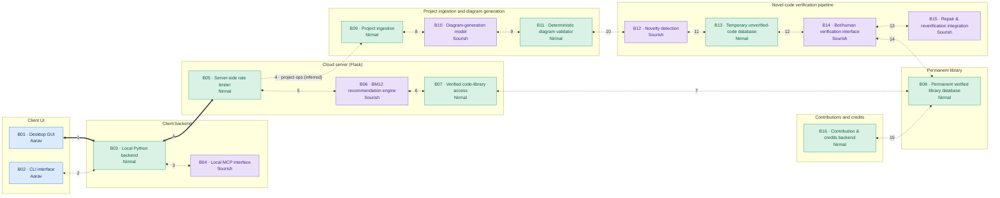

# Plovane — System Architecture and Inter-Block Data Transfer Handbook

**Document version:** 0.1 (draft)  
**Date:** 13 October 2026  
**Status:** Draft for engineering review  
**Purpose:** Show how Plovane's 16 blocks fit together, who owns each one, and exactly what data crosses every boundary.  
**Contents:** Part A is the architecture guide (diagram, inventories, flows, review notes, machine-readable registry). Part B is the full Inter-Block Data Transfer Handbook text, sections 1 to 20.

## Part A — Architecture guide

### A.1 How to read this document

- **Audience:** the three developers (Nirmal, Aarav, Sourish) and any AI assistant working on the codebase.
- **Source of truth:** Part B is the handbook and defines the contracts. Part A is a derived summary. If the two ever disagree, Part B wins; report the mismatch.
- **Spec status words:** *Established* means an agreed decision. *Proposed* means a draft contract awaiting review. *Open* means unresolved and must not be treated as decided (handbook §1.2).
- **Only two things are established:** the local GUI ↔ backend transport and envelope (§4.1), and the local backend ↔ cloud HTTPS + JSON transport (§4.2). Every other schema is a proposal.
- **Do not infer transports.** Where a connection is marked "Not finalized", do not assume HTTP, IPC or anything else just because JSON is exchanged (§4.3).
- **IDs used here:** blocks B01 to B16, connections 1 to 15, open decisions OD-1 to OD-4, review notes G1 to G12. Data identifiers such as `block_id` are opaque snake_case strings (§3.3).
- **Ownership versus interface ownership:** each block has one primary owner. Interface owners agree the contract at a boundary and never take over the block itself (§2.3).

### A.2 Architecture diagram

Blocks are coloured by primary owner. Every number is a connection ID that matches the connection map in A.4. The PDF edition shows the same diagram as a drawn figure.



Reading the diagram:

- Thick solid arrows (1 and 4) have an established transport. Dashed arrows have a transport that is not finalized.
- Connections 1, 3 and 5 are the three formally shared interfaces (§2.3).
- Connections 5 and 10 have no payload contract in the handbook yet (see G1 and G2).
- The dashed path from the cloud server to B09 is the route for project submission and diagram requests (§5.3 to §5.5). It is inferred, because the handbook does not spell out how B09 is reached.
- B04 is drawn as a side branch of B03 rather than a hop on the path to the cloud. See A.7 for the reasoning.

### A.3 Block inventory

| ID | Component | Category | Primary owner | Group |
|---|---|---|---|---|
| B01 | Desktop GUI | UI | Aarav | Client UI |
| B02 | CLI interface | UI / client interface | Aarav | Client UI |
| B03 | Local Python backend | Client backend | Nirmal | Client backend |
| B04 | Local MCP interface | MCP / AI integration | Sourish | Client backend |
| B05 | Server-side rate limiter | Server backend | Nirmal | Cloud server |
| B06 | BM12 recommendation engine | AI / recommendation | Sourish | Cloud server |
| B07 | Verified code-library access | Backend | Nirmal | Cloud server |
| B08 | Permanent verified library database | Database | Nirmal | Permanent library |
| B09 | Project ingestion | Backend | Nirmal | Ingestion & diagram generation |
| B10 | Diagram-generation model | AI | Sourish | Ingestion & diagram generation |
| B11 | Deterministic diagram validator | Backend | Nirmal | Ingestion & diagram generation |
| B12 | Novelty detection | AI / backend integration | Sourish | Verification pipeline |
| B13 | Temporary unverified-code database | Database | Nirmal | Verification pipeline |
| B14 | Bot/human verification interface | Verification / AI integration | Sourish | Verification pipeline |
| B15 | Repair and reverification integration | AI / verification | Sourish | Verification pipeline |
| B16 | Contribution and credits backend | Backend / database | Nirmal | Contributions |


Owner totals: Nirmal owns 8 blocks (B03, B05, B07, B08, B09, B11, B13, B16), Sourish owns 6 (B04, B06, B10, B12, B14, B15), Aarav owns 2 (B01, B02). Ownership of components that combine AI and backend work is a proposed allocation that the team must confirm (§2.2, G12).

### A.4 Connection map

| # | Connection | Blocks | Transport | Payload status | Handbook § | Interface owners |
|---|---|---|---|---|---|---|
| 1 | Desktop GUI ↔ Local Python backend | B01–B03 | HTTP on 127.0.0.1, JSON, prefix /api/v1/ (established) | Envelope established; operation schemas proposed | §4.1, §5 | Nirmal + Aarav (shared) |
| 2 | CLI ↔ Local Python backend | B02–B03 | Not finalized | Reuses core operation schemas (§5.2, §5.4) | §6 | Aarav, Nirmal (coordinate) |
| 3 | Local Python backend ↔ Local MCP interface | B03–B04 | Not finalized (out of scope) | JSON payload proposed (operation + input; standard envelope on response) | §7 | Nirmal + Sourish (shared) |
| 4 | Local Python backend ↔ Cloud server (Flask) | B03–B05 | HTTPS, JSON (established) | Operation-specific schemas proposed | §4.2, §8 | Nirmal |
| 5 | Rate limiter ↔ BM12 recommendation engine | B05–B06 | Not finalized | GAP: no schema yet; boundary needs joint review | none yet | Nirmal + Sourish (shared) |
| 6 | BM12 ↔ Verified code-library access | B06–B07 | Not finalized | Canonical code-block format proposed; no request/lookup payload defined | §5.2 (code block) | Sourish, Nirmal (coordinate) |
| 7 | Library access ↔ Permanent library database | B07–B08 | Not finalized | Code-block format proposed | §5.2 (code block) | Nirmal |
| 8 | Project ingestion ↔ Diagram-generation model | B09–B10 | Not finalized | JSON contract proposed | §9 | Nirmal, Sourish (coordinate) |
| 9 | Diagram-generation model ↔ Deterministic validator | B10–B11 | Not finalized | Diagram and validation-result contracts proposed | §10 | Sourish, Nirmal (coordinate) |
| 10 | Diagram validator → Novelty detection | B11–B12 | Not finalized | GAP: not defined in the handbook; present in the original diagram | none (see §11.1 for the likely input) | Nirmal, Sourish (coordinate) |
| 11 | Novelty detection ↔ Temporary unverified DB | B12–B13 | Not finalized | Candidate and novelty-result contracts proposed | §11 | Sourish, Nirmal (coordinate) |
| 12 | Temporary unverified DB ↔ Verification | B13–B14 | Not finalized | Verification contract proposed | §12 | Nirmal, Sourish (coordinate) |
| 13 | Repair ↔ Reverification (B15 ↔ B14) | B14–B15 | Not finalized | Revision-aware contract proposed | §13 (reuses §12) | Sourish |
| 14 | Verification ↔ Permanent verified library | B14–B08 | Not finalized | Admission contract proposed | §14 | Sourish, Nirmal (coordinate) |
| 15 | Contribution and credits ↔ Permanent library (as drawn originally) | B16–B08 | Not finalized | Contribution and outcome contracts proposed | §15 | Nirmal |


### A.5 Canonical schemas and shared vocabularies

| Schema | Fields | Defined in | Reused by |
|---|---|---|---|
| Code block | `block_id`, `name`, `language`, `code`, `comments`, `dependencies[]` (all required; dependencies is an array of strings) | §5.2 | §7, §8.2, §11, §12, §14, §15 |
| Recommendation request | `project_id` (string or null), `description`, `language`, `tech_stack[]`, `context_code` (string or null), `requested_count` (positive integer). Cloud version adds `request_id`, `user_id` | §5.1, §8.1 | §7.1 |
| Response envelope | `ok`, `data`, `error` | §4.1 | §7.2 |
| Error object | `code`, `message`. Codes: INVALID_REQUEST, UNAUTHENTICATED, FORBIDDEN, NOT_FOUND, CONFLICT, INTERNAL_ERROR | §16.2 | all boundaries that return structured errors |
| Project files | `project_id`, `files[]` with `path`, `content` (ingestion adds `language`) | §5.5, §9.1 | — |
| Diagram | `project_id`, `diagram.nodes[]` (`node_id`, `label`, `node_type` = function / file / folder, `source_path`), `diagram.edges[]` (`source_node_id`, `target_node_id`, `relationship`) | §5.4 | §9.2, §10.1 |
| Validation result | `project_id`, `valid`, `issues[]` (`code`, `message`, `node_id` or null) | §10.2 | — |
| Novelty result | `project_id`, `results[]` (`block_id`, `is_new`) | §11.2 | — |
| Verification input and result | input: `submission_id`, `code_block`. Result: `submission_id`, `block_id`, `status`, `issues[]` (`code`, `message`) | §12 | §13.2 adds `revision`; §14.1 |
| Revised block | `submission_id`, `block_id`, `revision` (positive integer), `language`, `code`, `comments`, `dependencies` (no `name`) | §13.1 | — |
| Library admission | `submission_id`, `code_block`, `verification` (`status`, `revision`); acknowledgement: `block_id`, `status` | §14 | — |
| Contribution | `contribution_id`, `user_id`, `source` (manual_submission / completed_project), `code_blocks[]`; outcome adds `credit_outcome` | §15 | — |
| Authentication | login and registration: `email`, `password`, `machine_id`; login response: `user_id`, `session_token`, `expires_at` | §8.3 | — |


Status values and what they mean. The same word appears in several places, so check the context:

| Where | Field | Values | Meaning |
|---|---|---|---|
| §5.5 project submission response | `status` | `accepted` | Accepted for processing. Not verified and not in the library. |
| §11.3 temporary storage acknowledgement | `status` | `pending_verification` | Receipt confirmed; verification has not happened. |
| §12.2 and §13.2 verification result | `status` | `passed`, `failed` (`in_progress` optional) | Outcome of verification. Failure is a valid result, not a transport error. |
| §14.2 library admission acknowledgement | `status` | `accepted` | Admitted to the permanent library. |
| §15.2 contribution outcome | `status` | `accepted` | Contribution accepted. |
| §15.2 credit outcome | `credit_outcome.status` | `pending`, `awarded` (full list open) | State of the credit award. |
| §10.2 and §11.2 | `valid`, `is_new` | `true`, `false` | Booleans, not status strings. |


### A.6 End-to-end data flows

These flows are derived from the diagram and the contracts. Steps marked as inferred are not spelled out in the handbook.

**Flow 1: code recommendation**

1. A recommendation request (§5.1) reaches B03 from the Desktop GUI (connection 1), the CLI (2) or the MCP interface (3).
2. B03 sends the cloud version of the request (§8.1, which adds `request_id` and `user_id`) over HTTPS (4) to the rate limiter B05.
3. B05 passes the request to the BM12 engine B06 (5, schema not yet defined).
4. B06 gets candidate blocks through library access B07 (6), which reads the permanent library B08 (7). Blocks use the canonical code-block structure (§5.2).
5. The answer returns along the same path: §8.2 to B03 (it echoes `request_id`), then to the caller as §5.2 data inside the §4.1 envelope (§7.2 for MCP).

**Flow 2: project submission and diagram generation**

1. The client submits project files (§5.5). B03 forwards them to the cloud (4); the route to B09 is inferred.
2. B09 ingests the project and sends the files, now with `language` (§9.1), to the diagram model B10 (8).
3. B10 returns the canonical diagram (§9.2) to the validator B11 (9), which returns a validation result (§10.2).
4. The client asks for the diagram with §5.3 and receives §5.4. The `accepted` status on submission only means "accepted for processing".

**Flow 3: novel code, verification and library admission**

1. Candidate code blocks go to novelty detection B12 (10). The contract for this hop is missing; the input shape is §11.1.
2. B12 returns `is_new` per block (§11.2). Blocks that proceed are submitted to the temporary database B13 with a `submission_id` (11), which acknowledges with `pending_verification` (§11.3).
3. B13 hands each block to verification B14 (12, §12.1), which returns `passed` or `failed` (§12.2).
4. Failed blocks can be repaired and re-verified through B15 (13). The revised block carries a `revision`, and the result names the exact revision tested (§13).
5. Passed blocks are admitted to the permanent library B08 (14, §14.1) and acknowledged with `accepted`.
6. Contributions and credits (§15) run through B16 (15): a contribution has a `source` of `manual_submission` or `completed_project`, and the outcome carries a `credit_outcome`.

### A.7 Changes made to the original diagram

The original infographic was redrawn. Nothing in the contracts was changed; only the picture and its labels.

| Issue in the original | What the new diagram does |
|---|---|
| B08 appeared twice, once in the server group and once as the Permanent Verified Library. | Drawn once, in its own Permanent library group. |
| Connection numbers on the arrows did not match the standards table. For example, arrow 3 sat between the MCP interface and the rate limiter, yet 3 means backend ↔ MCP; arrow 4 sat between the rate limiter and BM12, yet 4 means backend ↔ cloud. | Every number now sits on the connection it names. The numbering follows the handbook's contract register. |
| The MCP interface was drawn in series between the client backend and the server. | B04 is a side branch of B03. §7 defines a request (`operation`, `input`) and a response in the local application's standard envelope, and no section routes cloud traffic through MCP. This is an interpretation for Sourish to confirm. |
| Section references were wrong for connections 5, 6, 7, 10 and 11, and the Key Data Formats panel used numbers (4.1 to 5.12) that do not exist in the handbook. | References are re-keyed to the real section numbers. Connections 5 and 10 have no section and are marked as gaps. |
| Group titles read like co-ownership, for example "Nirmal + Sourish", and B05 was shown as owned by two people. The client group said "Aarav + Me". | Each box shows its single primary owner. Shared ownership appears only on interfaces 1, 3 and 5 (§2.3). Names replace "Me". |
| Arrow 14 sat between B15 and B16, but 14 is Verification ↔ Permanent library. | 14 now runs from B14 to B08, and 15 from B16 to B08, as the original routed it. |
| B14 was labelled just "Verification". | Full name: Bot/human verification interface. |
| The Open Decisions panel listed three items. | Four are shown (OD-1 to OD-4), matching §18.1 to §18.4. |
| No way to tell which transports were settled. | Thick solid arrows mark established transports; dashed arrows mark not finalized ones. Gold rings mark shared interfaces and red badges mark missing contracts. |
| No route from the client to project ingestion. | A dashed path from the cloud server to B09 shows the project operations route (inferred). |


### A.8 Review notes and gaps

These are findings from comparing the diagram with the handbook. They are for the owners to resolve; none has been silently applied to the contracts.

- **G1: connection 10 has no contract.** The diagram links the validator (B11) to novelty detection (B12), but the handbook defines nothing for that hop. §11.1 shows the likely input.
- **G2: connection 5 has no schema.** The rate limiter ↔ BM12 boundary is a shared interface that §17 marks as needing joint review. Nirmal and Sourish must define it before the freeze.
- **G3: connections 6 and 7 only reuse the code-block shape.** There are no request or lookup payloads for retrieving blocks from the library.
- **G4: the repair hand-off is undefined.** §12.2 defines a failed result and §13.1 a revised block, but nothing says who sends the failure to B15 or how the revised block is tied back to it.
- **G5: `revision` is missing from the §12.2 verification result.** §13.2 adds `revision` and §14.1 requires `verification.revision`, yet §13.2 says it reuses §12. Suggested fix, pending owner approval: add an optional `revision` to §12.2.
- **G6: `accepted` is overloaded.** It appears in §5.5 (accepted for processing), §14.2 (admitted to the library) and §15.2 (contribution accepted), while §14.2 warns it must not mean "received". Consider distinct values.
- **G7: the entry point into B16 is unspecified.** §15 defines the payloads but not which component calls B16, or how `completed_project` contributions arise.
- **G8: the cloud route to B09 is unspecified.** §5.5 defines the client submission, but not how it reaches project ingestion.
- **G9: cloud error format is undefined.** §4.2 has no universal envelope and §16.2 is only a proposed vocabulary. The local backend presumably maps cloud errors into the §4.1 envelope for the GUI and MCP, but this is not written down.
- **G10: human verification has no states.** B14 is a bot/human interface, yet the contract only has `passed` and `failed`. Sourish should say whether human review needs more states.
- **G11: handbook text corrected.** §5.4 said the relationship enumeration was an open decision "in section 12"; it is §18.2 and Part B now says so. Separately, §18 and §19 speak of three open decisions while §18.4 adds a fourth item (engineering confirmation).
- **G12: hybrid ownership needs confirmation.** §2.2 says AI/backend hybrid allocations are proposed but does not list them. Based on their categories, B04, B12, B14 and B15 are the ones to confirm.

### A.9 Open decisions

| ID | Handbook § | Topic | Question |
|---|---|---|---|
| OD-1 | §18.1 | Large project transfer | Can project contents always be sent as JSON text, or must the contract support an archive or project reference? |
| OD-2 | §18.2 | Diagram relationship types | Which relationship values must the diagram schema support? Only `calls` appears as an example. |
| OD-3 | §18.3 | Contribution credit units | Which credit types and units will the contribution outcome expose? `compute` is only an example. |
| OD-4 | §18.4 | Engineering confirmation | Owners must confirm hybrid AI/backend allocations, authentication payloads and operation-specific schemas. |


### A.10 Machine-readable registry

The same blocks and connections as JSON, for tools and AI assistants.

```json
{
  "document": {
    "title": "Plovane — System Architecture and Inter-Block Data Transfer Handbook",
    "version": "0.1 (draft)",
    "date": "2026-10-13",
    "status": "Draft for engineering review"
  },
  "owners": {
    "Nirmal": "all backend components, server-side backend, databases",
    "Aarav": "all user-interface components",
    "Sourish": "AI components, MCP, recommendation engine"
  },
  "blocks": [
    {
      "id": "B01",
      "name": "Desktop GUI",
      "category": "UI",
      "primary_owner": "Aarav",
      "group": "Client UI"
    },
    {
      "id": "B02",
      "name": "CLI interface",
      "category": "UI / client interface",
      "primary_owner": "Aarav",
      "group": "Client UI"
    },
    {
      "id": "B03",
      "name": "Local Python backend",
      "category": "Client backend",
      "primary_owner": "Nirmal",
      "group": "Client backend"
    },
    {
      "id": "B04",
      "name": "Local MCP interface",
      "category": "MCP / AI integration",
      "primary_owner": "Sourish",
      "group": "Client backend"
    },
    {
      "id": "B05",
      "name": "Server-side rate limiter",
      "category": "Server backend",
      "primary_owner": "Nirmal",
      "group": "Cloud server"
    },
    {
      "id": "B06",
      "name": "BM12 recommendation engine",
      "category": "AI / recommendation",
      "primary_owner": "Sourish",
      "group": "Cloud server"
    },
    {
      "id": "B07",
      "name": "Verified code-library access",
      "category": "Backend",
      "primary_owner": "Nirmal",
      "group": "Cloud server"
    },
    {
      "id": "B08",
      "name": "Permanent verified library database",
      "category": "Database",
      "primary_owner": "Nirmal",
      "group": "Permanent library"
    },
    {
      "id": "B09",
      "name": "Project ingestion",
      "category": "Backend",
      "primary_owner": "Nirmal",
      "group": "Ingestion & diagram generation"
    },
    {
      "id": "B10",
      "name": "Diagram-generation model",
      "category": "AI",
      "primary_owner": "Sourish",
      "group": "Ingestion & diagram generation"
    },
    {
      "id": "B11",
      "name": "Deterministic diagram validator",
      "category": "Backend",
      "primary_owner": "Nirmal",
      "group": "Ingestion & diagram generation"
    },
    {
      "id": "B12",
      "name": "Novelty detection",
      "category": "AI / backend integration",
      "primary_owner": "Sourish",
      "group": "Verification pipeline"
    },
    {
      "id": "B13",
      "name": "Temporary unverified-code database",
      "category": "Database",
      "primary_owner": "Nirmal",
      "group": "Verification pipeline"
    },
    {
      "id": "B14",
      "name": "Bot/human verification interface",
      "category": "Verification / AI integration",
      "primary_owner": "Sourish",
      "group": "Verification pipeline"
    },
    {
      "id": "B15",
      "name": "Repair and reverification integration",
      "category": "AI / verification",
      "primary_owner": "Sourish",
      "group": "Verification pipeline"
    },
    {
      "id": "B16",
      "name": "Contribution and credits backend",
      "category": "Backend / database",
      "primary_owner": "Nirmal",
      "group": "Contributions"
    }
  ],
  "connections": [
    {
      "id": 1,
      "from": "B01",
      "to": "B03",
      "name": "Desktop GUI ↔ Local Python backend",
      "handbook_sections": [
        "4.1",
        "5"
      ],
      "transport": "HTTP on 127.0.0.1, JSON, prefix /api/v1/ (established)",
      "transport_established": true,
      "payload_status": "Envelope established; operation schemas proposed",
      "interface_owners": "Nirmal + Aarav",
      "shared_interface": true,
      "contract_missing": false
    },
    {
      "id": 2,
      "from": "B02",
      "to": "B03",
      "name": "CLI ↔ Local Python backend",
      "handbook_sections": [
        "6"
      ],
      "transport": "Not finalized",
      "transport_established": false,
      "payload_status": "Reuses core operation schemas (§5.2, §5.4)",
      "interface_owners": "Aarav, Nirmal (coordinate)",
      "shared_interface": false,
      "contract_missing": false
    },
    {
      "id": 3,
      "from": "B03",
      "to": "B04",
      "name": "Local Python backend ↔ Local MCP interface",
      "handbook_sections": [
        "7"
      ],
      "transport": "Not finalized (out of scope)",
      "transport_established": false,
      "payload_status": "JSON payload proposed (operation + input; standard envelope on response)",
      "interface_owners": "Nirmal + Sourish",
      "shared_interface": true,
      "contract_missing": false
    },
    {
      "id": 4,
      "from": "B03",
      "to": "B05",
      "name": "Local Python backend ↔ Cloud server (Flask)",
      "handbook_sections": [
        "4.2",
        "8"
      ],
      "transport": "HTTPS, JSON (established)",
      "transport_established": true,
      "payload_status": "Operation-specific schemas proposed",
      "interface_owners": "Nirmal",
      "shared_interface": false,
      "contract_missing": false
    },
    {
      "id": 5,
      "from": "B05",
      "to": "B06",
      "name": "Rate limiter ↔ BM12 recommendation engine",
      "handbook_sections": [],
      "transport": "Not finalized",
      "transport_established": false,
      "payload_status": "GAP: no schema yet; boundary needs joint review",
      "interface_owners": "Nirmal + Sourish",
      "shared_interface": true,
      "contract_missing": true
    },
    {
      "id": 6,
      "from": "B06",
      "to": "B07",
      "name": "BM12 ↔ Verified code-library access",
      "handbook_sections": [
        "5.2"
      ],
      "transport": "Not finalized",
      "transport_established": false,
      "payload_status": "Canonical code-block format proposed; no request/lookup payload defined",
      "interface_owners": "Sourish, Nirmal (coordinate)",
      "shared_interface": false,
      "contract_missing": false
    },
    {
      "id": 7,
      "from": "B07",
      "to": "B08",
      "name": "Library access ↔ Permanent library database",
      "handbook_sections": [
        "5.2"
      ],
      "transport": "Not finalized",
      "transport_established": false,
      "payload_status": "Code-block format proposed",
      "interface_owners": "Nirmal",
      "shared_interface": false,
      "contract_missing": false
    },
    {
      "id": 8,
      "from": "B09",
      "to": "B10",
      "name": "Project ingestion ↔ Diagram-generation model",
      "handbook_sections": [
        "9"
      ],
      "transport": "Not finalized",
      "transport_established": false,
      "payload_status": "JSON contract proposed",
      "interface_owners": "Nirmal, Sourish (coordinate)",
      "shared_interface": false,
      "contract_missing": false
    },
    {
      "id": 9,
      "from": "B10",
      "to": "B11",
      "name": "Diagram-generation model ↔ Deterministic validator",
      "handbook_sections": [
        "10"
      ],
      "transport": "Not finalized",
      "transport_established": false,
      "payload_status": "Diagram and validation-result contracts proposed",
      "interface_owners": "Sourish, Nirmal (coordinate)",
      "shared_interface": false,
      "contract_missing": false
    },
    {
      "id": 10,
      "from": "B11",
      "to": "B12",
      "name": "Diagram validator → Novelty detection",
      "handbook_sections": [],
      "transport": "Not finalized",
      "transport_established": false,
      "payload_status": "GAP: not defined in the handbook; present in the original diagram",
      "interface_owners": "Nirmal, Sourish (coordinate)",
      "shared_interface": false,
      "contract_missing": true
    },
    {
      "id": 11,
      "from": "B12",
      "to": "B13",
      "name": "Novelty detection ↔ Temporary unverified DB",
      "handbook_sections": [
        "11"
      ],
      "transport": "Not finalized",
      "transport_established": false,
      "payload_status": "Candidate and novelty-result contracts proposed",
      "interface_owners": "Sourish, Nirmal (coordinate)",
      "shared_interface": false,
      "contract_missing": false
    },
    {
      "id": 12,
      "from": "B13",
      "to": "B14",
      "name": "Temporary unverified DB ↔ Verification",
      "handbook_sections": [
        "12"
      ],
      "transport": "Not finalized",
      "transport_established": false,
      "payload_status": "Verification contract proposed",
      "interface_owners": "Nirmal, Sourish (coordinate)",
      "shared_interface": false,
      "contract_missing": false
    },
    {
      "id": 13,
      "from": "B14",
      "to": "B15",
      "name": "Repair ↔ Reverification (B15 ↔ B14)",
      "handbook_sections": [
        "13",
        "12"
      ],
      "transport": "Not finalized",
      "transport_established": false,
      "payload_status": "Revision-aware contract proposed",
      "interface_owners": "Sourish",
      "shared_interface": false,
      "contract_missing": false
    },
    {
      "id": 14,
      "from": "B14",
      "to": "B08",
      "name": "Verification ↔ Permanent verified library",
      "handbook_sections": [
        "14"
      ],
      "transport": "Not finalized",
      "transport_established": false,
      "payload_status": "Admission contract proposed",
      "interface_owners": "Sourish, Nirmal (coordinate)",
      "shared_interface": false,
      "contract_missing": false
    },
    {
      "id": 15,
      "from": "B16",
      "to": "B08",
      "name": "Contribution and credits ↔ Permanent library (as drawn originally)",
      "handbook_sections": [
        "15"
      ],
      "transport": "Not finalized",
      "transport_established": false,
      "payload_status": "Contribution and outcome contracts proposed",
      "interface_owners": "Nirmal",
      "shared_interface": false,
      "contract_missing": false
    }
  ],
  "open_decisions": [
    {
      "id": "OD-1",
      "handbook_section": "§18.1",
      "topic": "Large project transfer"
    },
    {
      "id": "OD-2",
      "handbook_section": "§18.2",
      "topic": "Diagram relationship types"
    },
    {
      "id": "OD-3",
      "handbook_section": "§18.3",
      "topic": "Contribution credit units"
    },
    {
      "id": "OD-4",
      "handbook_section": "§18.4",
      "topic": "Engineering confirmation"
    }
  ],
  "spec_status_vocabulary": [
    "established",
    "proposed",
    "open"
  ]
}
```

## Part B — Handbook v0.1 (full text, sections 1 to 20)

Part B reproduces the handbook text. One correction was applied: the cross-reference in §5.4 now points to §18.2.

### 1. Purpose and scope

This handbook defines how data is exchanged between Plovane's components.

It specifies:

- Inputs and outputs at component boundaries.
- JSON payload structures and data types.
- Transport protocols where established.
- Required fields, optional fields, and validation rules.
- Shared responsibility for implementing and maintaining interfaces.
- Error formats and compatibility expectations.

#### 1.1 Out of scope

This handbook does not define the internal implementation of individual components. Specifically, it does not specify:

- AI model architecture or recommendation algorithms.
- Database internals, indexing, or database technology choices.
- Rate-limiting algorithms, queues, or orchestration.
- Internal MCP transport implementation.
- Internal verification algorithms.
- Proprietary model implementation details.

Each component's internal implementation remains the responsibility of its assigned developer.

#### 1.2 Status of specifications

The document distinguishes between:

- **Established:** Explicitly agreed project decisions.
- **Proposed:** Draft interface contracts that require engineering review.
- **Open:** Decisions that must be resolved before the affected interface is frozen.

A schema appearing in this document is not automatically a confirmed production API.

---

### 2. Developer ownership and accountability

#### 2.1 Primary ownership

| Developer | Primary responsibility |
|---|---|
| **Nirmal** | All backend components, server-side backend functionality, and databases |
| **Aarav** | All user-interface components |
| **Sourish** | AI components, MCP, and the recommendation engine |

These assignments establish primary ownership of each component.

#### 2.2 Component ownership register

| ID | Component | Category | Primary owner |
|---|---|---|---|
| B01 | Desktop GUI | UI | Aarav |
| B02 | CLI interface | UI / client interface | Aarav |
| B03 | Local Python backend | Client backend | Nirmal |
| B04 | Local MCP interface | MCP / AI integration | Sourish |
| B05 | Server-side rate limiter | Server backend | Nirmal |
| B06 | BM12 recommendation engine | AI / recommendation | Sourish |
| B07 | Verified code-library access | Backend | Nirmal |
| B08 | Permanent verified library database | Database | Nirmal |
| B09 | Project ingestion | Backend | Nirmal |
| B10 | Diagram-generation model | AI | Sourish |
| B11 | Deterministic diagram validator | Backend | Nirmal |
| B12 | Novelty detection | AI / backend integration | Sourish |
| B13 | Temporary unverified-code database | Database | Nirmal |
| B14 | Bot/human verification interface | Verification / AI integration | Sourish |
| B15 | Repair and reverification integration | AI / verification | Sourish |
| B16 | Contribution and credits backend | Backend / database | Nirmal |

**Ownership note:** The assignments for components that combine AI and backend responsibilities are a proposed allocation based on the agreed ownership categories. They must be confirmed by the team before implementation. The primary owner remains accountable for the component itself.

#### 2.3 Shared responsibility for data exchange

When two developers are listed for an interface, their shared responsibility applies only to the **contract and exchange between the two components**.

It does not transfer ownership of either component.

| Interface | Interface owners | Responsibility |
|---|---|---|
| Desktop GUI ↔ local Python backend | Nirmal + Aarav | Agree on requests, responses, validation, and error handling |
| Local Python backend ↔ MCP interface | Nirmal + Sourish | Agree on JSON payloads passed between the client backend and MCP-facing component |
| Server-side rate limiter ↔ BM12 recommendation engine | Nirmal + Sourish | Agree on the payload and response contract across this boundary |

For every shared interface, both developers must agree on the contract before either side treats it as final. Each developer remains responsible for implementing and maintaining their own component.

For interfaces not explicitly listed as shared, the primary owners of the connected components must coordinate the interface as needed.

---

### 3. Global data conventions

These conventions apply across contracts unless an individual interface specifies otherwise.

#### 3.1 JSON

- Structured data uses JSON.
- Field names use `snake_case`.
- Strings use UTF-8 encoding.
- Lists use JSON arrays.
- Boolean values use `true` or `false`.
- Identifiers are strings unless specified otherwise.
- Unknown optional values should be omitted or represented as `null` according to the field's schema.
- An empty array (`[]`) represents a known empty collection, not a missing value.

#### 3.2 Timestamps

Timestamps use ISO 8601 UTC format, for example:

`2026-10-13T08:30:00Z`

#### 3.3 Identifiers

The following identifier names are used consistently:

| Identifier | Meaning |
|---|---|
| `user_id` | User identity |
| `machine_id` | Client machine identity |
| `project_id` | Project identity |
| `request_id` | Individual request identity |
| `block_id` | Code-block identity |
| `submission_id` | Code submission identity |
| `contribution_id` | Contribution identity |
| `node_id` | Diagram-node identity |

Identifiers are opaque strings. A receiving component must not infer their internal structure unless the relevant contract explicitly permits it.

#### 3.4 Source code

Source code is transferred as a string in JSON payloads.

- Newlines must be preserved.
- Code must not be silently reformatted during transfer.
- The language must be identified where required.
- Dependencies must be represented as an array of strings.
- Comments or usage notes must remain distinct from executable source code.

#### 3.5 Schema compatibility

- Adding an optional field should not break existing consumers.
- Removing a required field or changing its type requires coordinated changes.
- Changing the meaning of an existing field requires a contract revision.
- A component must not silently substitute one data type for another.

---

### 4. Established transport standards

#### 4.1 Desktop GUI ↔ local Python backend

**Status: Established**

| Property | Standard |
|---|---|
| Transport | HTTP |
| Host | `127.0.0.1` |
| Payload format | JSON |
| API prefix | `/api/v1/` |
| Response format | Standard response envelope |

Successful response:

```json
{
  "ok": true,
  "data": {},
  "error": null
}
```

Error response:

```json
{
  "ok": false,
  "data": null,
  "error": {
    "code": "INVALID_REQUEST",
    "message": "The request is invalid"
  }
}
```

The `data` object is defined separately for each operation.

This envelope is mandatory for the desktop-facing local API unless a later contract revision explicitly changes it.

#### 4.2 Local Python backend ↔ cloud Flask server

**Status: Established**

| Property | Standard |
|---|---|
| Transport | HTTPS |
| Payload format | JSON |
| Request schema | Operation-specific |
| Response schema | Operation-specific |

There is no requirement for every server operation to use a universal request envelope.

The local backend and cloud server must agree on each operation's payload, success response, and error response.

#### 4.3 MCP and internal server-side connections

The JSON payload contracts are documented in this handbook. Transport protocols for these connections remain unspecified unless explicitly established elsewhere.

The handbook must not infer HTTP, IPC, or another transport merely because two components exchange JSON.

---

### 5. Client application contracts

#### 5.1 Recommendation request

The client requests code recommendations using this proposed payload:

```json
{
  "project_id": "proj_123",
  "description": "Add CSV parsing and validation",
  "language": "python",
  "tech_stack": [
    "python",
    "pandas"
  ],
  "context_code": "def load_data(path):\n    pass",
  "requested_count": 5
}
```

| Field | Type | Requirement |
|---|---|---|
| `project_id` | string or null | Required |
| `description` | string | Required, non-empty |
| `language` | string | Required |
| `tech_stack` | array of strings | Required |
| `context_code` | string or null | Required |
| `requested_count` | integer | Required, positive |

A missing project or code context is represented by `null`. The requested count is a preference, not a guarantee that the same number of recommendations will be returned.

#### 5.2 Recommendation response

The `data` field of the standard response envelope uses this structure:

```json
{
  "recommendations": [
    {
      "block_id": "blk_001",
      "name": "csv_validator",
      "language": "python",
      "code": "def validate_csv(path):\n    ...",
      "comments": "Validates CSV input before processing.",
      "dependencies": [
        "pandas"
      ]
    }
  ]
}
```

| Field | Type | Requirement |
|---|---|---|
| `recommendations` | array | Required |
| `block_id` | string | Required |
| `name` | string | Required |
| `language` | string | Required |
| `code` | string | Required |
| `comments` | string | Required |
| `dependencies` | array of strings | Required |

A recommendation response may contain zero, one, or multiple code blocks.

This contract describes the returned data only. It does not define how BM12 finds or ranks code.

#### 5.3 Diagram request

```json
{
  "project_id": "proj_123"
}
```

The project identifier is required.

#### 5.4 Diagram response

The `data` object contains:

```json
{
  "project_id": "proj_123",
  "diagram": {
    "nodes": [
      {
        "node_id": "node_001",
        "label": "load_data",
        "node_type": "function",
        "source_path": "src/data.py"
      }
    ],
    "edges": []
  }
}
```

Node fields:

| Field | Type |
|---|---|
| `node_id` | string |
| `label` | string |
| `node_type` | string |
| `source_path` | string |

The permitted node types are:

- `function`
- `file`
- `folder`

An edge uses this structure:

```json
{
  "source_node_id": "node_001",
  "target_node_id": "node_002",
  "relationship": "calls"
}
```

The source and target IDs must refer to nodes present in the same diagram.

The complete relationship enumeration remains an open decision (see section 18.2).

#### 5.5 Project submission

```json
{
  "project_id": "proj_123",
  "files": [
    {
      "path": "src/main.py",
      "content": "print('Hello')"
    },
    {
      "path": "README.md",
      "content": "# Project"
    }
  ]
}
```

Each file contains a relative project path and its text content.

The proposed success response is:

```json
{
  "submission_id": "sub_123",
  "status": "accepted"
}
```

The status `accepted` means the submission was accepted for processing; it does not mean that its code has passed verification or entered the permanent library.

The transfer format for large projects remains open.

---

### 6. CLI ↔ application contract

The CLI must reuse the same core operation schemas as the GUI wherever both interfaces invoke the same application operation.

| Item | Requirement |
|---|---|
| Operation payloads | Reuse the relevant client API schemas |
| Recommendation data | Reuse section 5.2 |
| Diagram data | Reuse section 5.4 |
| Error semantics | Remain consistent with the corresponding operation |
| CLI command syntax | Defined separately as a user-interface concern |

The CLI must not introduce an incompatible recommendation or diagram data model merely because the user invokes the operation through a terminal.

The exact CLI-to-application transport has not been finalized in this document.

---

### 7. MCP ↔ local application contract

The transport mechanism is out of scope. This section defines the JSON payload passed across the boundary.

#### 7.1 Request

```json
{
  "operation": "recommend_code",
  "input": {
    "project_id": "proj_123",
    "description": "Add CSV parsing and validation",
    "language": "python",
    "tech_stack": [
      "python",
      "pandas"
    ],
    "context_code": "def load_data(path):\n    pass",
    "requested_count": 5
  }
}
```

The `operation` field identifies the requested operation. The `input` object follows the schema for that operation.

#### 7.2 Response

```json
{
  "ok": true,
  "data": {
    "recommendations": [
      {
        "block_id": "blk_001",
        "name": "csv_validator",
        "language": "python",
        "code": "def validate_csv(path):\n    ...",
        "comments": "Validates CSV input before processing.",
        "dependencies": [
          "pandas"
        ]
      }
    ]
  },
  "error": null
}
```

Failure response:

```json
{
  "ok": false,
  "data": null,
  "error": {
    "code": "INVALID_REQUEST",
    "message": "The request is invalid"
  }
}
```

The response uses the standard envelope established for the local application interface.

---

### 8. Local backend ↔ cloud server contract

The local backend sends requests to the cloud using HTTPS and JSON.

#### 8.1 Recommendation request

```json
{
  "request_id": "req_123",
  "user_id": "usr_123",
  "project_id": "proj_123",
  "description": "Add CSV parsing and validation",
  "language": "python",
  "tech_stack": [
    "python",
    "pandas"
  ],
  "context_code": "def load_data(path):\n    pass",
  "requested_count": 5
}
```

#### 8.2 Recommendation response

```json
{
  "request_id": "req_123",
  "recommendations": [
    {
      "block_id": "blk_001",
      "name": "csv_validator",
      "language": "python",
      "code": "def validate_csv(path):\n    ...",
      "comments": "Validates CSV input before processing.",
      "dependencies": [
        "pandas"
      ]
    }
  ]
}
```

The request includes `request_id` and `user_id` in addition to the core recommendation input. The response echoes `request_id` so the caller can associate the result with the originating request.

These are proposed payload schemas. The cloud operation names and actual deployed endpoint paths are not established here.

#### 8.3 Authentication payloads

Proposed login request:

```json
{
  "email": "user@example.com",
  "password": "user_password",
  "machine_id": "machine_uuid"
}
```

Proposed login response:

```json
{
  "user_id": "usr_123",
  "session_token": "session_token_value",
  "expires_at": "2026-10-14T08:30:00Z"
}
```

Proposed registration request:

```json
{
  "email": "user@example.com",
  "password": "user_password",
  "machine_id": "machine_uuid"
}
```

Proposed registration response:

```json
{
  "user_id": "usr_123"
}
```

The password field is shown only to define the login/registration payload. Password storage and credential-handling internals are outside this handbook.

The session mechanism and token-expiry policy require implementation review before these schemas are frozen.

---

### 9. Project ingestion ↔ diagram model

**Status:** Proposed JSON contract. Internal transport is not yet established.

#### 9.1 Input

```json
{
  "project_id": "proj_123",
  "files": [
    {
      "path": "src/main.py",
      "language": "python",
      "content": "def main():\n    pass"
    }
  ]
}
```

Each file contains:

| Field | Type | Requirement |
|---|---|---|
| `path` | string | Required |
| `language` | string | Required |
| `content` | string | Required |

The project identifier and files array are required.

#### 9.2 Output

The output uses the canonical diagram structure in section 5.4:

```json
{
  "project_id": "proj_123",
  "diagram": {
    "nodes": [
      {
        "node_id": "node_001",
        "label": "main",
        "node_type": "function",
        "source_path": "src/main.py"
      }
    ],
    "edges": []
  }
}
```

The diagram schema must be shared across all components that exchange diagram data. Separate, incompatible diagram formats are not permitted.

---

### 10. Diagram model ↔ deterministic validator

#### 10.1 Input

The validator accepts the canonical diagram object defined in section 5.4.

#### 10.2 Output

Successful validation:

```json
{
  "project_id": "proj_123",
  "valid": true,
  "issues": []
}
```

Failed validation:

```json
{
  "project_id": "proj_123",
  "valid": false,
  "issues": [
    {
      "code": "INVALID_EDGE_REFERENCE",
      "message": "An edge references a node that does not exist",
      "node_id": null
    }
  ]
}
```

| Field | Type |
|---|---|
| `project_id` | string |
| `valid` | boolean |
| `issues` | array |
| `issues[].code` | string |
| `issues[].message` | string |
| `issues[].node_id` | string or null |

The validator's issue codes must be documented and remain stable once consumers depend on them.

This section specifies the result format, not the validator's internal checking logic.

---

### 11. Novelty detection ↔ temporary unverified storage

#### 11.1 Input to novelty detection

```json
{
  "project_id": "proj_123",
  "code_blocks": [
    {
      "block_id": "blk_candidate_001",
      "name": "csv_validator",
      "language": "python",
      "code": "def validate_csv(path):\n    ...",
      "comments": "Validates CSV input.",
      "dependencies": [
        "pandas"
      ]
    }
  ]
}
```

Each element uses the canonical code-block structure defined in section 5.2.

#### 11.2 Novelty result

```json
{
  "project_id": "proj_123",
  "results": [
    {
      "block_id": "blk_candidate_001",
      "is_new": true
    }
  ]
}
```

| Field | Type |
|---|---|
| `project_id` | string |
| `results` | array |
| `results[].block_id` | string |
| `results[].is_new` | boolean |

This result communicates whether a candidate should proceed as novel code. It does not specify how novelty is determined.

#### 11.3 Submission to temporary storage

```json
{
  "submission_id": "sub_123",
  "project_id": "proj_123",
  "code_blocks": [
    {
      "block_id": "blk_candidate_001",
      "name": "csv_validator",
      "language": "python",
      "code": "def validate_csv(path):\n    ...",
      "comments": "Validates CSV input.",
      "dependencies": [
        "pandas"
      ]
    }
  ]
}
```

Acknowledgement:

```json
{
  "submission_id": "sub_123",
  "status": "pending_verification"
}
```

The acknowledgement confirms receipt for verification. It does not indicate successful verification.

---

### 12. Temporary storage ↔ verification

#### 12.1 Verification input

```json
{
  "submission_id": "sub_123",
  "code_block": {
    "block_id": "blk_candidate_001",
    "name": "csv_validator",
    "language": "python",
    "code": "def validate_csv(path):\n    ...",
    "comments": "Validates CSV input.",
    "dependencies": [
      "pandas"
    ]
  }
}
```

#### 12.2 Verification result

```json
{
  "submission_id": "sub_123",
  "block_id": "blk_candidate_001",
  "status": "passed",
  "issues": []
}
```

Permitted final statuses:

- `passed`
- `failed`

An intermediate `in_progress` status may be added if the interface requires progress reporting.

Failed result:

```json
{
  "submission_id": "sub_123",
  "block_id": "blk_candidate_001",
  "status": "failed",
  "issues": [
    {
      "code": "TEST_FAILURE",
      "message": "A verification test failed"
    }
  ]
}
```

A verification failure is a valid result of a verification operation. It is not automatically a transport-level error.

---

### 13. Repair ↔ reverification

A revised code block must be distinguishable from the earlier version.

#### 13.1 Revised block

```json
{
  "submission_id": "sub_123",
  "block_id": "blk_candidate_001",
  "revision": 2,
  "language": "python",
  "code": "def validate_csv(path):\n    ...",
  "comments": "Validates CSV input.",
  "dependencies": [
    "pandas"
  ]
}
```

`revision` is a positive integer.

#### 13.2 Reverification result

```json
{
  "submission_id": "sub_123",
  "block_id": "blk_candidate_001",
  "revision": 2,
  "status": "passed",
  "issues": []
}
```

The result must identify the exact revision that was tested. Consumers must not interpret a result for revision 1 as a result for revision 2.

The verification status and issue structure reuse section 12.

---

### 14. Verification ↔ permanent verified library

A code block is eligible for admission to the permanent verified library only after it passes the required verification process.

#### 14.1 Admission payload

```json
{
  "submission_id": "sub_123",
  "code_block": {
    "block_id": "blk_candidate_001",
    "name": "csv_validator",
    "language": "python",
    "code": "def validate_csv(path):\n    ...",
    "comments": "Validates CSV input.",
    "dependencies": [
      "pandas"
    ]
  },
  "verification": {
    "status": "passed",
    "revision": 2
  }
}
```

#### 14.2 Admission acknowledgement

```json
{
  "block_id": "blk_candidate_001",
  "status": "accepted"
}
```

`accepted` confirms admission to the permanent library. It must not be used merely to mean that a submission was received.

The library's internal storage schema and database technology are outside this handbook.

---

### 15. Contribution ↔ credits

#### 15.1 Contribution submission

```json
{
  "contribution_id": "contrib_123",
  "user_id": "usr_123",
  "source": "manual_submission",
  "code_blocks": [
    {
      "block_id": "blk_candidate_001",
      "name": "csv_validator",
      "language": "python",
      "code": "def validate_csv(path):\n    ...",
      "comments": "Validates CSV input.",
      "dependencies": [
        "pandas"
      ]
    }
  ]
}
```

Proposed `source` values:

- `manual_submission`
- `completed_project`

#### 15.2 Contribution outcome

```json
{
  "contribution_id": "contrib_123",
  "status": "accepted",
  "credit_outcome": {
    "status": "pending"
  }
}
```

When credits are awarded:

```json
{
  "contribution_id": "contrib_123",
  "status": "accepted",
  "credit_outcome": {
    "status": "awarded",
    "credit_type": "compute",
    "amount": 100
  }
}
```

The credit type and amount shown are illustrative, not approved production values.

The final schema must specify the available credit types, the unit associated with each type, and the permitted outcome statuses. The internal credit calculation is outside scope.

---

### 16. Error contract

#### 16.1 Local API errors

The desktop-facing local API must use the response envelope defined in section 4.1.

#### 16.2 Other boundary errors

Where a boundary returns a structured error, the proposed error object is:

```json
{
  "code": "INVALID_REQUEST",
  "message": "The request is invalid"
}
```

Recommended error codes:

| Code | Meaning |
|---|---|
| `INVALID_REQUEST` | Missing, malformed, or invalid input |
| `UNAUTHENTICATED` | Valid authentication is absent |
| `FORBIDDEN` | The caller is not authorized |
| `NOT_FOUND` | A referenced resource does not exist |
| `CONFLICT` | The operation conflicts with the current resource state |
| `INTERNAL_ERROR` | An unexpected failure occurred |

Each interface must document the errors it can return. The list above is a proposed shared vocabulary, not a requirement that every block support every code.

#### 16.3 Error semantics

1. Validation failures must identify the relevant error category.
2. Successful operations with no results should return an empty collection where appropriate.
3. Domain outcomes such as verification failure must be represented as operation results when the operation itself completed successfully.
4. A transport failure must not be represented as a successful result.
5. Error messages may change for clarity; consumers should rely on stable error codes.

---

### 17. Contract register

| Connection | Transport | Payload status |
|---|---|---|
| GUI ↔ local backend | Local HTTP + JSON | Envelope established; operation schemas proposed |
| CLI ↔ application | Not finalized | Reuse core operation schemas |
| Local backend ↔ MCP | Not finalized | JSON payload proposed |
| Local backend ↔ cloud server | HTTPS + JSON | Transport established; operation schemas proposed |
| Rate limiter ↔ BM12 | Not finalized | Boundary schema requires joint review |
| BM12 ↔ verified library access | Not finalized | Canonical code-block format proposed |
| Library access ↔ permanent database | Not finalized | Code-block format proposed |
| Project ingestion ↔ diagram model | Not finalized | JSON contract proposed |
| Diagram model ↔ validator | Not finalized | Diagram and validation-result contracts proposed |
| Novelty detection ↔ temporary database | Not finalized | Candidate and novelty-result contracts proposed |
| Temporary database ↔ verification | Not finalized | Verification contract proposed |
| Repair ↔ reverification | Not finalized | Revision-aware contract proposed |
| Verification ↔ permanent library | Not finalized | Admission contract proposed |
| Contribution ↔ credits | Not finalized | Contribution and outcome contracts proposed |

"Not finalized" means that the transport, deployment arrangement, or production schema is not established by the current project decisions. It does not mean the connection cannot be implemented.

---

### 18. Open decisions before schema freeze

The following decisions remain unresolved and must not be silently treated as confirmed.

#### 18.1 Large project transfer

**Question:** Can project contents always be transferred as JSON text, or must the contract support an archive or project reference for large projects?

This affects the project-submission and ingestion contracts.

#### 18.2 Diagram relationship types

**Question:** Which relationship values must the diagram schema support?

The current example includes `calls`, but the complete allowed enumeration has not been approved.

#### 18.3 Contribution credit units

**Question:** Which credit types and units will the contribution outcome expose?

The example uses compute credits, but the available types and units have not been finalized.

#### 18.4 Engineering confirmation

The proposed component allocations for hybrid AI/backend responsibilities, the authentication payloads, and the operation-specific schemas must be reviewed by their owners before production implementation.

---

### 19. Final review checklist

Before publishing this handbook as the approved interface specification:

- [ ] Nirmal confirms the backend and database interfaces.
- [ ] Aarav confirms the UI-facing requests and responses.
- [ ] Sourish confirms the MCP and AI-facing payload contracts.
- [ ] Shared-interface owners agree on the three jointly owned boundaries.
- [ ] The three open contract decisions in section 18 are resolved.
- [ ] Every implemented operation has a required-field and type definition.
- [ ] Every operation documents its success response and applicable errors.
- [ ] The canonical code-block and diagram schemas are consistent across connections.
- [ ] Any proposed schema that differs from the actual implementation is reconciled before release.
- [ ] The team approves the version and records subsequent breaking changes.

---

### 20. Approval

| Role | Responsibility | Approval |
|---|---|---|
| Nirmal | Backend, databases, and assigned shared interfaces | Pending |
| Aarav | UI and assigned shared interfaces | Pending |
| Sourish | AI, MCP, recommendation engine, and assigned shared interfaces | Pending |

**Document status:** Draft for engineering review.

This handbook is intended to establish a common language for inter-block communication. Component implementation remains the responsibility of each assigned developer, while jointly owned interfaces require agreement between both parties before their contracts are considered final.
